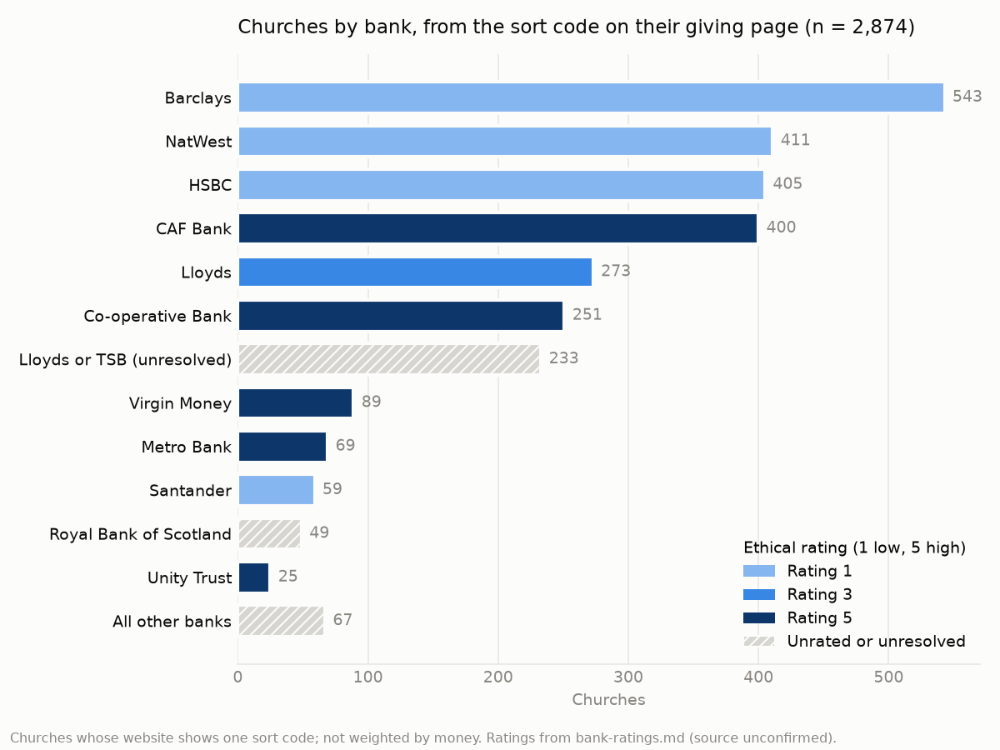

# Which bank do churches use? Sort code results

*FaithTech BUILD, 10 October 2026. Branch `sortcode-db`.*

Many churches never name their bank, but their website giving page shows a sort code. We built a table that turns a UK sort code into the bank behind it, then ran it over church giving pages found by the team's crawl, Martin's scrape and an OpenStreetMap list of churches.

## Headline numbers

- **2,949 charities and churches** show a sort code on their website. **2,252** of them are confirmed churches (a congregation or its PCC, see "Is every row a church?"), and **2,185** of those show exactly one code.
- Of the 2,185 churches, by the bank's ethical rating in `bank-ratings.md`:

| Rating | Churches | Share |
|---|---|---|
| 1 (low) | 1,089 | 50% |
| 3 | 212 | 10% |
| 5 (high) | 644 | 29% |
| Unrated or unresolved | 240 | 11% |

- Biggest banks: Barclays 405, HSBC 320, NatWest 307, CAF Bank 306, Lloyds 192, Co-operative Bank 183; 183 more are Lloyds or TSB, unresolved.
- **Checked against the OpenStreetMap church list:** 601 of the 2,252 churches are on it, and their split is the same within a few points (584 with one code: 52% rating 1, 9% rating 3, 27% rating 5, 12% unrated). The other 1,651 are not missing churches, just churches OpenStreetMap does not list (its sheet has 6,000 of the UK's roughly 40,000).
- **All 2,874 single-code rows, non-churches included,** split almost the same way: 1,430 (50%) rating 1, 296 (10%) rating 3, 837 (29%) rating 5, 311 (11%) unrated. Removing non-churches does not change the headline.
- **Accuracy:** on 719 church pages from the team crawl that print one sort code with one bank named beside it, the table agreed with the page 711 times (**98.9%**), measured before any church-page rows were added. For the newer sources see "Where the churches came from".

## Where the churches came from

| Source (`origin` column) | Churches | What it is |
|---|---|---|
| `team_crawl` | 2,401 | The team's crawl of 9 to 10 October (`bankwell_churches_matched.csv`) |
| `team_recrawl` | 217 | Team-list charities whose site gave no code first time (11,276 sites) or did not load (5,090), re-crawled with the improved pattern below |
| `martin` | 156 | Charities in Martin's `scraped_sort_codes.csv` (branch `martin`) with no code from the team crawl or re-crawl |
| `osm` | 170 | Churches from the OpenStreetMap list whose website is not in the team list. No charity number, so no income |
| `team_via_osm` | 5 | A code the OpenStreetMap crawl found on a team charity's own website |

- **Improved pattern.** The original crawler only accepted a code written straight after "sort code". Real pages also write `Sort code: *`, `Sort Code |`, `SC:`, `Bank Code:`, or the code beside an account number with no label. On 305 of Martin's pages the new pattern found 283 codes against 138, and it found nothing on 150 pages known to have no code.
- **Martin's codes were re-checked.** His scraper did not need the words "sort code", so dates, phone numbers and placeholders such as `12-13-14` got in. Each of his pages was fetched again with the new pattern: 132 charities kept a code that passed (`verified=anchored`), 24 kept his code because the page did not load (`verified=martin_only`, treat with care), 62 were dropped.
- **OpenStreetMap rows.** 24 Northern Ireland churches were dropped (BT postcode or an NI bank), and 241 duplicates of charities that already had a code.
- **Agreement on the new rows** (548 churches): where the page names one bank, our answer matched 177 times, was one of the candidates 16 times, and conflicted 13 times. This is weaker evidence than the 98.9%, because the crawler records any bank named anywhere on the page, not only beside the code.

## Is every row a church?

Not all of them. `church_check.py` marks each row `church` (a congregation or its PCC), `not_church` or `unsure` in three steps, each overriding the one before:

1. **Rules:** the Charity Commission's own classification ("Religious Activities"), the charity's activities text, the name, and the teammates' church list of 10 October.
2. **Review of the rules' unsure rows** (`results/church_check_decisions.csv`, 525 rows): AI agents judged each from its name and activities text, then a script fetched every charity's homepage (517 loaded) and looked for service times. Where the two disagreed the row was decided by hand from the page text.
3. **OpenStreetMap is the source of truth:** a charity whose website or giving page is on the OpenStreetMap church list (`Bankwell Data Analysis - All UK Churches (OpenStreetMap).csv`, 6,000 churches) is `church`, whatever steps 1 and 2 said. Matched by website domain, or by full address on directory sites used by many churches (achurchnearyou.com, salvationarmy.org.uk).

| `church_check` | Rows | How decided |
|---|---|---|
| `church` | 2,252 | Rules 1,893; review 144; OpenStreetMap 45 charities plus the 170 OpenStreetMap rows |
| `not_church` | 655 | Rules 316 (Friends-of groups, funds, schools, halls, foodbanks, YMCAs, other faiths); review 339 (mission agencies, youth work, aid charities, religious orders, umbrella bodies) |
| `unsure` | 42 | Still unclear after review. Listed in `results/church_check_review.csv`, largest income first |

- **Accuracy of the rules (hand-checked samples of 50):** 48 of 50 `church` rows are clearly congregations (misses: a religious order and a church-and-industry centre); 49 of 50 `not_church` rows are clearly not (the miss has been fixed).
- **Review step:** agent calls are judgement from public text, not verified fact. The site check confirmed service times for 87 of the 119 churches the agents named; the other 32 were kept or moved to `unsure` by reading their activities.
- **How many confirmed churches are on the OpenStreetMap sheet** (`in_osm` column): 170 are OpenStreetMap rows, 390 share a website with a listed church, 24 share a postcode and a name word, 17 share a postcode district and two name words; 1,651 are not found. The sheet lists 6,000 churches (4,054 with a postcode), so most real churches are absent: mainly PCCs and Baptist and Methodist churches. Only a website match changes `church_check`; name and postcode matches are fuzzy and shown for information.
- **OpenStreetMap overrides 16 rule-based `not_church` rows**, mostly Friends-of groups and church halls whose giving page is the church's own site. The sort code on those pages is probably the church's account, so `church` is defensible there; the old rule result is kept in `church_reason`.
- **The teammates' church list (`filtered data.csv`) disagrees on 478 rows:** it keeps 464 rows marked `not_church` here (mission agencies, mosques, Friends-of groups, church schools) and leaves out 14 marked `church`. It adds no new charities, websites or banks (all 23,188 rows are in the team list with identical values), so it is used as one signal, not as the definition.
- A church-attached fund, hall, school or Christian charity counts as `not_church`, because Bank Well's target is the congregation's own bank account.

## Files

| File | What it is |
|---|---|
| `results/church_banks_extended.csv` | **Main file.** One row per church with a sort code, from every source: `origin`, charity number, name, income, denomination, sort code, **bank, group, rating**, match type, the bank printed on the page, the page URL, `verified` and a rough `maybe_not_church` flag |
| `results/church_check_review.csv` | The 42 `unsure` rows with name, income, classification, activities text, website and page URL, for a person to decide |
| `results/church_check_decisions.csv` | Review decisions for the rules' unsure rows (`charity_number`, `decision`, `note`, `source`); add a row here to settle one by hand |
| `results/sort_code_map_extended.csv` | One row per sort code seen (1,243 codes): bank, group, rating, and how many churches use it |
| `results/church_banks.csv`, `results/sort_code_map.csv` | The same for the team crawl alone (2,401 churches, 1,042 codes) |
| `results/churches_by_bank.png` | The chart above |
| `sort_codes.csv`, `institutions.csv` | The sort-code table itself (every row cites a public source) |
| `sortcode_lookup.py` | Look up any sort code: `python sortcode_lookup.py 60-01-73` |
| `crawl_sort_codes.py` | Crawls church websites for a sort code on the giving page |
| `church_banks.py`, `extend_sources.py`, `church_check.py`, `make_chart.py` | Rebuild the results (see README) |
| `README.md` | How the table works, how to add a row, licensing |

Join to anything else on **`charity_number`** (OpenStreetMap rows use `osm:<type>/<id>`, for example `osm:node/4118141`, instead).

## How to read the columns

- `match`: `exact` (the code itself is listed, e.g. CAF Bank 40-52-40), `range` (falls in a bank's range), `ambiguous` (more than one bank possible), `unknown`.
- **Lloyds or TSB:** TSB kept its branch sort codes when it split from Lloyds in 2013, so many codes could be either (Lloyds is rated 3, TSB 1). Where a church page names the bank we use it; 233 churches stay ambiguous. For those, `likely_bank` says "Lloyds" with a note: 96% of 180 page-named 30-xx codes are Lloyds. That is an estimate, not a fact.
- `page_agrees`: whether the bank printed on the page matches our answer (`yes`, `candidate` for an ambiguous code, `no`).
- `shared_page`: above 0 means the code came from a page listing several churches, so it may belong to a sibling church. 253 churches; check by hand before relying on them.
- `maybe_not_church`: `yes` where the name looks like a hall, school, foodbank or similar (39 rows). Not removed. Superseded by `church_check`.
- `church_check`, `church_reason`: `church`, `not_church` or `unsure`, and the signals behind it. Rows are never removed; filter on `church_check = church` for church-only numbers.
- `in_osm`: where the row appears on the OpenStreetMap church sheet: `osm_row`, `website`, `postcode_name`, `district_name`, or blank (not found).
- Churches with several sort codes have values separated by `;` in the same order.

## Worth knowing

- **Agency banks hide inside big banks' ranges.** Euston Church's `60-01-73` looks like NatWest but is **Reliance Bank** (formerly the Salvation Army Bank). Likewise CAF Bank (40-52-40, inside HSBC), Charity Bank (60-83-16), Unity Trust (60-83-01) and Triodos (16-58-10). Guessing from the first two digits gets exactly the ethical banks wrong.
- **Church deposit funds are invisible here.** The CBF Church of England Deposit Fund and the Methodist CFB fund collect through an HSBC account (`40-05-30`), so money held in them cannot be seen from a sort code.
- Royal Bank of Scotland is part of NatWest Group but has no rating of its own in `bank-ratings.md`, so it shows as unrated.

## Limits before quoting any number

- These are churches whose website shows a sort code, not a random sample, and the counts are **not weighted by money**. The 170 OpenStreetMap churches have no income figure at all.
- A giving-page code is the donations account: usually, not always, the main bank.
- The file includes non-churches (schools, YMCAs, foodbanks): 655 marked `not_church` and 42 `unsure`, not removed.
- Ratings come from `bank-ratings.md`, whose source is still to be confirmed.
- Charity rows cover registered charities in England and Wales. OpenStreetMap rows may include churches in Scotland; Northern Ireland churches were removed.

## Next steps

1. **Read the "Bankers" line from the accounts PDFs** (about 7,600 Charity Commission and 2,300 Companies House documents already downloaded by the crawl). This covers churches with no sort code online and gives an independent check on these results.
2. Weight by money: join to income or cash figures to estimate how much church money sits at each rating.
3. Decide the 42 `unsure` rows (`results/church_check_review.csv`, record in `church_check_decisions.csv`), and hand-check the 253 shared-page rows and the 13 new-row conflicts.
4. Settle more Lloyds/TSB codes as church pages or published statements name them.
